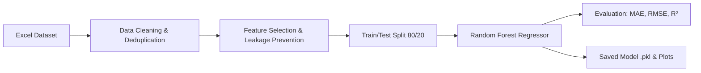
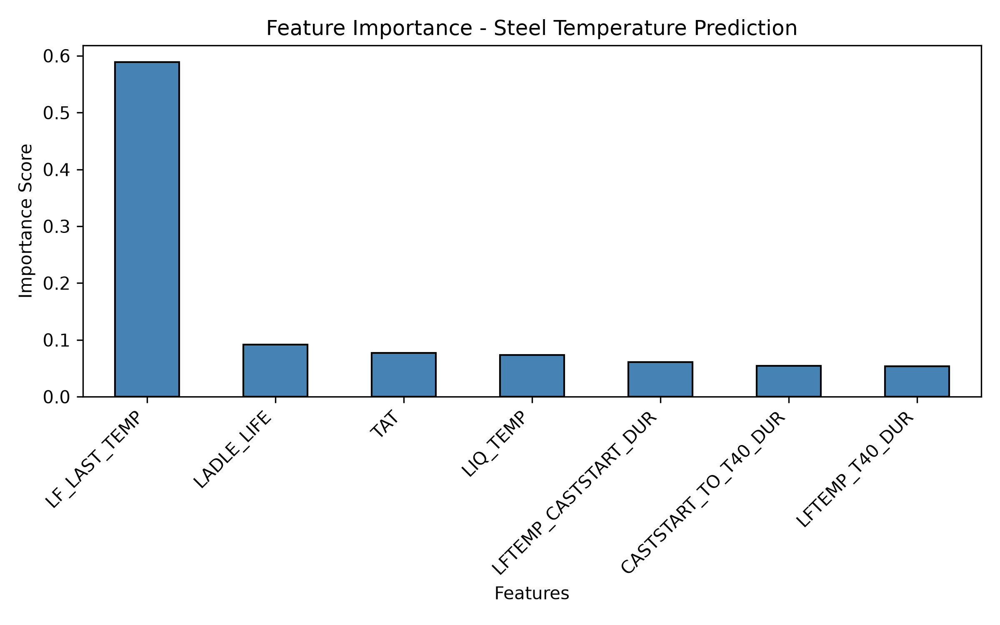
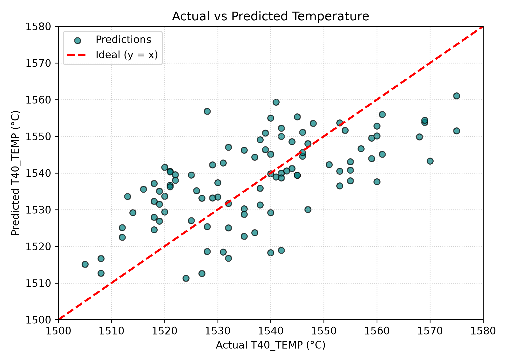

# AI/ML Modeling for Steel Temperature Prediction in Secondary Metallurgy


-darkred.svg)


> **Internship Project:** Predictive analytics and machine learning modeling for steelmaking operations at the Steel Melting Shop (SMP) to forecast liquid steel temperature during continuous casting.

---

## 📌 1. Project Overview

In steel manufacturing, controlling the temperature of molten steel between the **Ladle Furnace (LF)** and the **Continuous Casting Machine (CCM)** is critical for:
- Avoiding breakout and nozzle clogging during casting.
- Ensuring optimal steel quality, microstructure, and surface integrity.
- Reducing energy consumption and refractory wear by preventing excessive ladle superheating.

This project implements an end-to-end Machine Learning pipeline utilizing **Random Forest Regression** to predict the steel temperature at 40 minutes into casting (`T40_TEMP`) using process durations, thermal properties, and ladle parameters.

---

## 🎯 2. Objectives

- Predict molten steel temperature at the critical 40-minute casting mark (`T40_TEMP`).
- Prevent **target leakage** by excluding directly computed thermal drop features.
- Quantify the impact of process delays, ladle life, and turnaround times on thermal loss.
- Provide a reusable, serialized model artifact (`.pkl`) deployable in process automation workflows.

---

## 📊 3. Dataset & Feature Description

The dataset consists of heats monitored across the steelmaking route (LF $\rightarrow$ CCM).

### **Target Variable:**
* `T40_TEMP`: Liquid steel temperature recorded at 40 minutes after casting start (°C).

### **Input Features ($X$):**
| Feature Name | Description | Units |
| :--- | :--- | :--- |
| `LF_LAST_TEMP` | Last measured steel temperature at the Ladle Furnace | °C |
| `LIQ_TEMP` | Liquidus temperature based on steel chemistry | °C |
| `LFTEMP_CASTSTART_DUR` | Duration from last LF measurement to start of casting | Minutes |
| `CASTSTART_TO_T40_DUR` | Duration from cast start to the T40 measurement | Minutes |
| `LFTEMP_T40_DUR` | Total transit and casting elapsed time until T40 | Minutes |
| `LADLE_LIFE` | Number of heats processed with current refractory lining | Heats |
| `TAT` | Ladle Turnaround Time between successive operations | Hours/Min |

> **⚠️ Target Leakage Prevention:**  
> The variable `LF2T40_TEMP_DROP` is strictly defined as `LF_LAST_TEMP - T40_TEMP`. It is explicitly **excluded** from training features because including it would leak the target variable and artificially inflate performance without operational utility. `HEAT_ID` and raw timestamps are also excluded.

---

## ⚙️ 4. Machine Learning Methodology



1. **Preprocessing & Cleaning:**
   - Removal of duplicate heats.
   - Comprehensive handling of missing records across features and target.
2. **Train/Test Split:**
   - 80% Training set, 20% Testing set (fixed `random_state=42` for reproducibility).
3. **Model Architecture:**
   - **Random Forest Regressor** with tuned tree depth (`max_depth=8`) and minimum leaf samples (`min_samples_leaf=2`) to prevent overfitting on sample process data.

---

## 📈 5. Model Performance & Results

The model was evaluated on unseen test data:

| Metric | Result | Description |
| :--- | :--- | :--- |
| **MAE (Mean Absolute Error)** | **~10.93 °C** | Average deviation from actual temperature |
| **RMSE (Root Mean Squared Error)** | **~12.67 °C** | Standard deviation of prediction residuals |
| **$R^2$ Score** | **~0.3854** | Explains ~38.5% of variance with mock/sample data |

---

## 🔍 6. Visualizations & Insights

### **Feature Importance**
`LF_LAST_TEMP` is the primary thermal driver (~59%), followed by physical ladle condition (`LADLE_LIFE`) and process turnaround duration (`TAT`).



### **Actual vs. Predicted Temperature**
Scatter plot comparing predicted temperatures against ground truth values. The red dashed line denotes ideal 1:1 prediction ($y = x$).



---

## 📂 7. Repository Structure

```text
├── steel_model.py                     # Main ML training, evaluation, and plotting script
├── steel_temperature_random_sample.xlsx # Dataset (sample heats from SMP process)
├── steel_temperature_model.pkl        # Serialized trained model ready for deployment
├── prediction_results.csv             # Test set actual vs predicted values
├── feature_importance.png             # Feature importance visualization
├── actual_vs_predicted.png            # Actual vs predicted scatter plot
├── requirements.txt                   # Project dependencies
├── .gitignore                         # Git ignored files
└── README.md                          # Project documentation
```

---

## 🚀 8. Getting Started

### **Prerequisites**
- Python 3.10 or higher
- Git

### **Installation**
1. Clone this repository:
   ```bash
   git clone https://github.com/your-username/steel-temperature-prediction.git
   cd steel-temperature-prediction
   ```

2. Create and activate a virtual environment (optional but recommended):
   ```bash
   python -m venv venv
   # On Windows:
   .\venv\Scripts\activate
   # On Linux/macOS:
   source venv/bin/activate
   ```

3. Install required packages:
   ```bash
   pip install -r requirements.txt
   ```

### **Run the Model Pipeline**
Execute the training script:
```bash
python steel_model.py
```

The script will automatically:
- Load the dataset regardless of current working directory.
- Clean and split the data.
- Train the Random Forest Regressor.
- Print evaluation metrics (`MAE`, `RMSE`, `R²`).
- Save output graphs and export `prediction_results.csv` and `steel_temperature_model.pkl`.

---

## 💡 9. Using the Saved Model in Production

To load and make predictions on new heats without retraining:

```python
import joblib
import pandas as pd

# Load saved model
model = joblib.load("steel_temperature_model.pkl")

# New heat features: [LFTEMP_CASTSTART_DUR, CASTSTART_TO_T40_DUR, LFTEMP_T40_DUR, LIQ_TEMP, LF_LAST_TEMP, LADLE_LIFE, TAT]
new_heat = pd.DataFrame([{
    "LFTEMP_CASTSTART_DUR": 25,
    "CASTSTART_TO_T40_DUR": 40,
    "LFTEMP_T40_DUR": 65,
    "LIQ_TEMP": 1515,
    "LF_LAST_TEMP": 1590,
    "LADLE_LIFE": 18,
    "TAT": 2.5
}])

predicted_temp = model.predict(new_heat)
print(f"Predicted T40 Temperature: {predicted_temp[0]:.2f} °C")
```

---

## 👤 Author & Acknowledgments

* **Project Developer:** Machine Learning Intern
* **Domain:** Steel Melting Shop (SMP) & Secondary Metallurgy
* **Tools Used:** Python, Pandas, NumPy, Scikit-Learn, Matplotlib, Joblib
